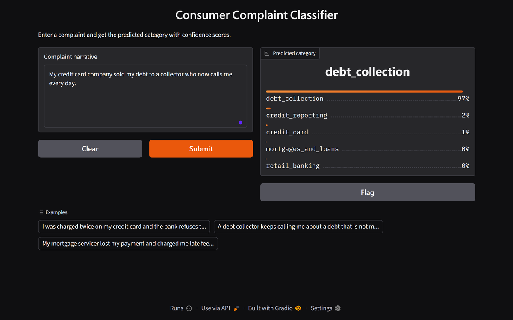
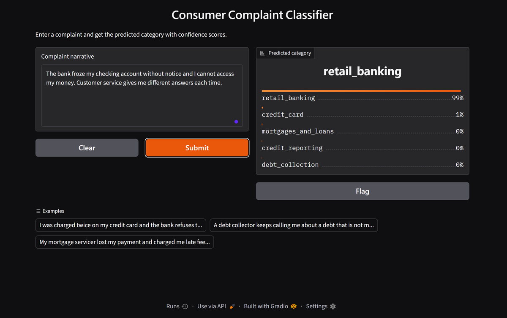
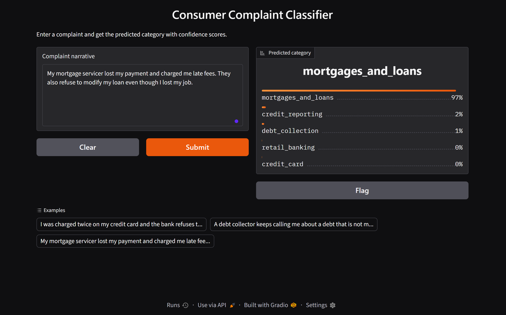
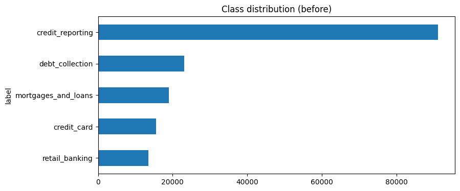
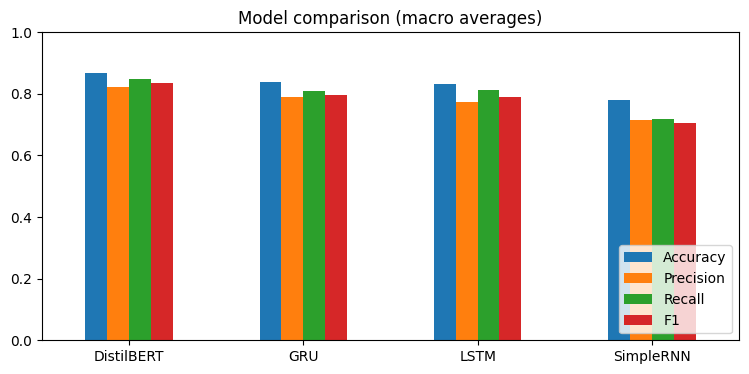
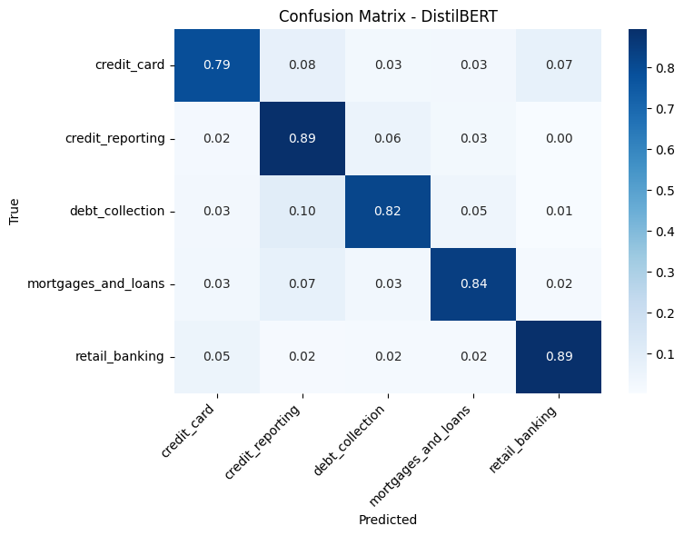

# 📨 Consumer Complaint Classification


A text classification system that reads a customer complaint and predicts which **product category** it belongs to, so it can be routed to the right team automatically. Four models are trained and compared on the same data split: **SimpleRNN, LSTM and GRU** (built from scratch in Keras) and a fine-tuned **DistilBERT** (HuggingFace). The best model is deployed as an interactive **Gradio** web app.


---

## 🌐 Links

- 📓 **Training notebook on Kaggle:** [consumer-complaint-classification-nlp](https://www.kaggle.com/code/abdelazizelshourbgy/consumer-complaint-classification-nlp)
- 🚀 **Live demo:** [https://huggingface.co/spaces/Abd3laziz1/consumer-complaint-classifier](https://huggingface.co/spaces/Abd3laziz1/consumer-complaint-classifier) <!-- update this link after creating the Space -->

## 📸 Demo

<p align="center">
  
  
</p>
<p align="center">
  
  
</p>

---

## ✨ Features

- Predicts **5 complaint categories** from free text
- Shows the confidence score for the top predictions
- Class-weighted training to handle the strong class imbalance
- Fair comparison: all four models are evaluated on exactly the same test set
- Ready-made examples in the web app

## 🗂️ Dataset

[Consumer Complaints Dataset for NLP](https://www.kaggle.com/datasets/shashwatwork/consume-complaints-dataset-fo-nlp) by shashwatwork on Kaggle (file `complaints_processed.csv`). Please check the dataset page for its license.

- **162,411** complaints in total, with two useful columns: `narrative` (the text) and `product` (the label)
- A random sample of **50,000** complaints (seed 42) was used to keep training fast. After removing texts with 3 words or fewer after cleaning, **49,582** remained
- Split (stratified): **34,707 train / 7,437 validation / 7,438 test**

| Class | Complaints in the 50k sample | Share |
|---|---|---|
| credit_reporting | 28,010 | 56.0% |
| debt_collection | 7,208 | 14.4% |
| mortgages_and_loans | 5,782 | 11.6% |
| credit_card | 4,818 | 9.6% |
| retail_banking | 4,182 | 8.4% |

The classes are imbalanced: `credit_reporting` is more than half of the data. This is handled with balanced **class weights** (from 0.36 for `credit_reporting` up to 2.39 for `retail_banking`) during training.



## 🧪 Method

**Preprocessing** (for the RNN models): lowercasing, removing numbers, punctuation and masked tokens like `XXXX`, removing stop words and very short words, and WordNet lemmatization. DistilBERT uses the original `narrative` text with its own tokenizer. Note that the text in this dataset already looks pre-cleaned (lowercase, no stop words).

| Model | Details |
|---|---|
| SimpleRNN / LSTM / GRU | Embedding (20,000 words, 100 dims) → recurrent layer (64 units) → Dropout 0.4 → Dense 64 → Dropout 0.3 → Softmax. Sequence length 200, batch 128, Adam, up to 15 epochs with early stopping (patience 3), class weights |
| DistilBERT | `distilbert-base-uncased`, 3 epochs, learning rate 2e-5, batch 16, max length 128, class-weighted cross-entropy, mixed precision. About 6.5 minutes on a Kaggle GPU |

---

## 📊 Results

### Comparison of the four models (test set, 7,438 complaints)

Scores are macro averages over the 5 classes. **F1** is the main metric because the classes are imbalanced.

| Model | Accuracy | Precision | Recall | F1 |
|---|---|---|---|---|
| **DistilBERT** | **0.867** | **0.821** | **0.848** | **0.834** |
| GRU | 0.838 | 0.790 | 0.809 | 0.796 |
| LSTM | 0.832 | 0.775 | 0.812 | 0.790 |
| SimpleRNN | 0.781 | 0.716 | 0.718 | 0.706 |



- **DistilBERT is the best model on every metric**, about 3.8 F1 points above the best RNN model (GRU). It starts from a pre-trained language model, so it needs far less to learn from.
- **GRU and LSTM are very close** (F1 0.796 vs 0.790). Each model was trained once, so this small gap should not be read as a real difference.
- **SimpleRNN is clearly the weakest.** Its validation accuracy was unstable between epochs (for example it dropped from 0.78 to 0.69 in one epoch), and it stopped early after 8 epochs.
- Macro recall is higher than macro precision for all four models. This is consistent with the class weights favoring the smaller classes (not tested separately).

### Per-class F1 (test set)

| Class | Test samples | SimpleRNN | LSTM | GRU | DistilBERT |
|---|---|---|---|---|---|
| credit_reporting | 4,151 | 0.87 | 0.89 | 0.90 | **0.92** |
| retail_banking | 623 | 0.61 | 0.81 | 0.83 | **0.88** |
| mortgages_and_loans | 866 | 0.75 | 0.78 | 0.77 | **0.82** |
| debt_collection | 1,076 | 0.67 | 0.74 | 0.74 | **0.78** |
| credit_card | 722 | 0.62 | 0.72 | 0.74 | **0.77** |

### DistilBERT confusion matrix (row-normalized)



- `credit_reporting` is the easiest class, and also the one the other classes get confused with most: 10% of `debt_collection`, 8% of `credit_card` and 7% of `mortgages_and_loans` complaints were predicted as `credit_reporting`.
- `credit_card` and `debt_collection` are the hardest classes. A possible reason (not verified) is that these complaints often mention credit reports and collectors too, so the topics overlap.
- The confidence scores in the demo are softmax outputs and are not calibrated probabilities, so a high confidence does not guarantee a correct answer.

---

## 📁 Project structure

```
consumer-complaint-classification/
├── app.py                                      # Gradio app
├── consumer-complaint-classification-nlp.ipynb # training, comparison and evaluation notebook
├── requirements.txt
├── assets/                                     # screenshots and charts
├── LICENSE
└── README.md
```

The trained model (`best_model/`, about 255 MB) is **not stored in this repository** because of GitHub's file size limit. It is available in the files of the [Hugging Face Space](https://huggingface.co/spaces/Abd3laziz1/consumer-complaint-classifier/tree/main/best_model) <!-- update this link -->, and it is also produced by the Kaggle notebook (`/kaggle/working/best_model`).

## 🚀 Run locally

```bash
git clone https://github.com/AbdelazizElshourbgy-ui/consumer-complaint-classification.git
cd consumer-complaint-classification

python -m venv venv
venv\Scripts\activate        # Windows
# source venv/bin/activate   # macOS / Linux

pip install -r requirements.txt
```

Download the `best_model/` folder (see above) and put it next to `app.py`, then run:

```bash
python app.py
```

Open the local address printed in the terminal (usually `http://127.0.0.1:7860`), type or paste a complaint in English, and press **Submit**. The app runs on CPU. You can also point to a model in another location with `MODEL_DIR=/path/to/best_model python app.py`.

## 🔁 Reproduce the training

Open the notebook on Kaggle, add the dataset **Consumer Complaints Dataset for NLP**, turn on a **GPU** and **Internet**, and press **Run All**. The whole notebook takes roughly 15 minutes, and DistilBERT training takes about 6.5 minutes.

DistilBERT runs in a separate Python process inside the notebook. PyTorch and TensorFlow shared one GPU in the same process and this was crashing the kernel, so they are kept apart.

## ⚠️ Limitations

- Only 50,000 of the 162,411 complaints were used, and each model was trained once, so small differences between models (for example GRU vs LSTM) are not reliable.
- No hyperparameter search was done. The settings are reasonable defaults.
- Strong class imbalance: `credit_reporting` is 56% of the data.
- The dataset text is already pre-processed, so real raw complaints can look different from the training data.
- English text only, and only 5 broad categories.
- Softmax confidence is not a calibrated probability.

## 🔮 Future work

- Train on the full dataset and run several seeds to measure variance
- Tune hyperparameters and try larger transformers (BERT, RoBERTa)
- Use pre-trained embeddings (GloVe / FastText) for the RNN models
- Calibrate the confidence scores
- Add more complaint categories and a "not sure" option for low-confidence predictions

## 🛠️ Tech stack

Python · TensorFlow / Keras · PyTorch · HuggingFace Transformers · scikit-learn · NLTK · Gradio · Pandas · Matplotlib · Kaggle

## 👤 Author

**Abdelaziz Elshourbgy**

GitHub: [@AbdelazizElshourbgy-ui](https://github.com/AbdelazizElshourbgy-ui) · LinkedIn: [Abdelaziz Elshourbgy](https://www.linkedin.com/in/abdelaziz-elshourbgy-b126a83a2/)

## 📄 License

Code released under the [MIT License](LICENSE). The dataset belongs to its original author; see its Kaggle page for the license.
